<p align="center">
  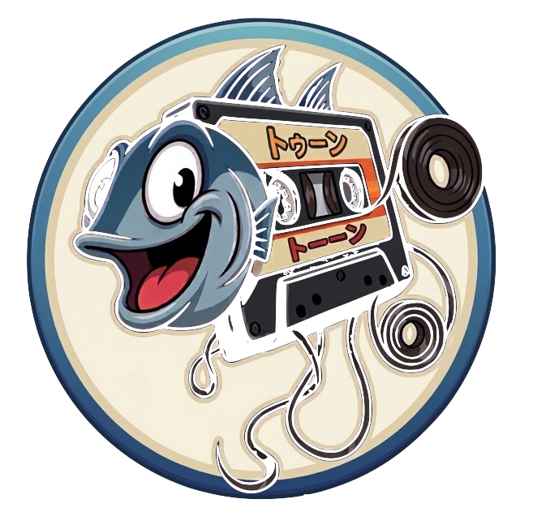
</p>

<h1 align="center">tunetape</h1>

<p align="center">
  <b>Stream music from YouTube, Spotify and KHInsider, right inside your terminal.</b><br>
  <sub>Paste a link. Press Enter. Listen. No browser, no tabs, no ads.</sub>
</p>

<p align="center">
  <a href="https://github.com/oauramos/tunetape/actions/workflows/ci.yml"></a>
  
  
  <a href="https://github.com/oauramos/tunetape/releases"></a>
  <a href="LICENSE"></a>
</p>

<p align="center">
  <a href="#install">Install</a> ·
  <a href="#how-it-works">How it works</a> ·
  <a href="#screens">Screens</a> ·
  <a href="#keys">Keys</a> ·
  <a href="https://github.com/oauramos/tunetape/wiki">Wiki</a>
</p>

<br>

<p align="center">
  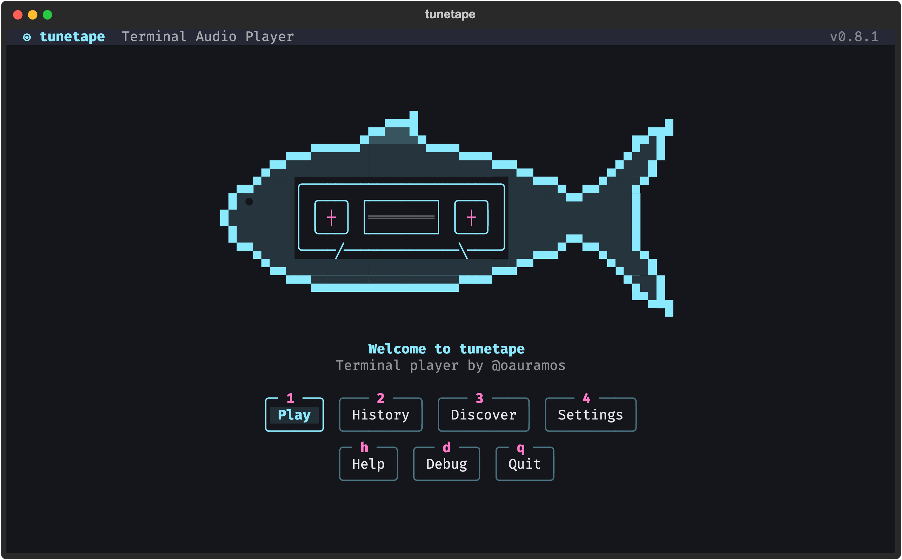
</p>

<br>

## What is tunetape?

tunetape is a small audio player that lives in your terminal. It hands the stream to [mpv](https://mpv.io/) (audio only) and wraps it in a btop-style interface you can drive with the keyboard or the mouse. Nothing is downloaded or stored; it just plays.

- **Three sources.** YouTube videos and playlists, Spotify tracks and playlists, and [KHInsider](https://downloads.khinsider.com) video game soundtracks. Paste any link and the source is detected as you type.
- **A player full of live data.** Live L/R levels with a loudness graph, plus the stream's codec, bitrate, sample rate, cache and download speed, all next to the track and its controls.
- **Playlists and albums.** Next and previous, auto-advance, and a queue you can jump around in.
- **Recently played.** Everything you play is remembered, and playlists resume at the track you left off.
- **Discover with AI.** Describe a vibe ("calm piano for focus") and get a list of real songs to play. Bring your own API key; the feature stays off until you add one.
- **Sounds even.** Optional loudness normalization keeps volume consistent across sources, and your last volume is remembered.
- **Themes.** More than twenty color themes with a live preview.
- **Fits any terminal.** macOS, Linux and Windows, down to 60 columns.

## Install

You need two tools on your machine, [mpv](https://mpv.io/) and [yt-dlp](https://github.com/yt-dlp/yt-dlp), plus tunetape itself. Pick your OS:

### macOS

One command via [Homebrew](https://brew.sh). It brings in Python, mpv and yt-dlp for you:

```bash
brew install oauramos/tunetape/tunetape
```

### Windows

```powershell
winget install shinchiro.mpv
winget install yt-dlp.yt-dlp
pip install git+https://github.com/oauramos/tunetape.git
```

### Linux

```bash
sudo apt install mpv yt-dlp        # or your distro's package manager
pip install git+https://github.com/oauramos/tunetape.git
```

### Run it

```bash
tunetape
```

That's it. Press **1**, paste a link, and press Enter.

> Want another way in? The install script, manual install, `uv`/`pipx`, upgrading and uninstalling are all covered in the wiki: **[Installation](https://github.com/oauramos/tunetape/wiki/Installation)**.

## How it works

### 1. Paste a link

Press **1** on the main menu and paste a YouTube, Spotify or KHInsider URL. tunetape tells you which source it found before you press Enter.

<p align="center">
  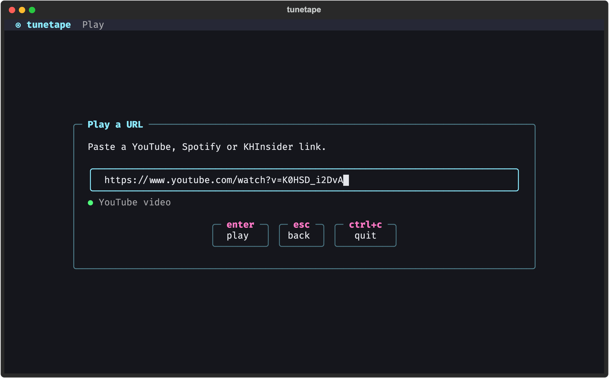
</p>

### 2. It loads

While the stream is fetched, a small box lists each step and how long it took.

<p align="center">
  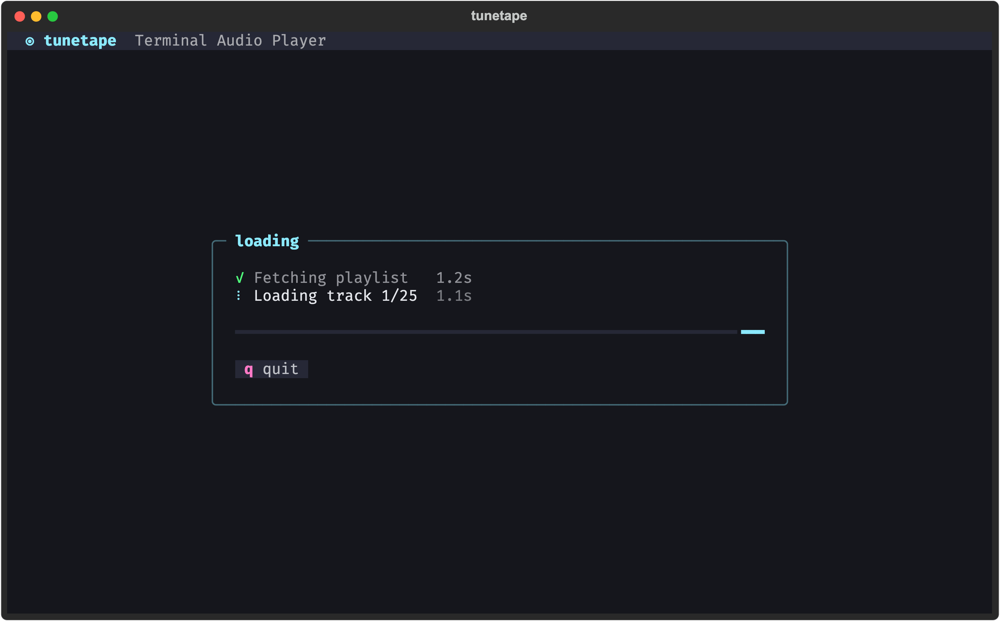
</p>

### 3. It plays

The player is a dashboard:

- **now playing:** the track, a progress bar (click it to seek), the controls and a volume gauge.
- **level:** live left and right levels with peak ticks, and a scrolling loudness graph.
- **stream:** the codec, bitrate, sample rate, cache ahead and download speed.

Long titles scroll across like a car radio display.

<p align="center">
  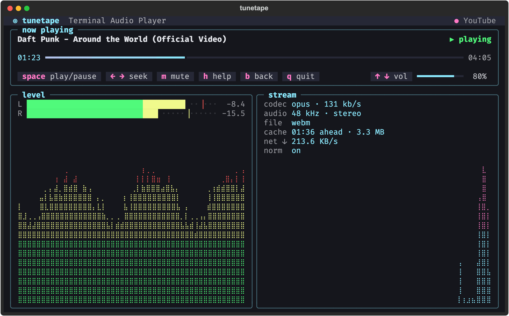
</p>

### 4. Playlists just work

Spotify playlists, YouTube playlists and KHInsider albums show the track position and add **n** / **p** for next and previous. Tracks advance on their own. On a wide terminal the queue sits alongside: press **tab** to move into it and **Enter** to jump to any track.

<p align="center">
  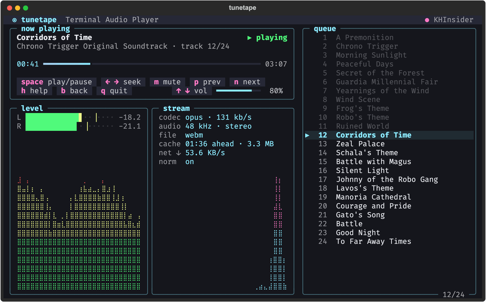
</p>

## Screens

### Recently played

Jump back into anything you have played. Playlists and albums resume where you stopped.

<p align="center">
  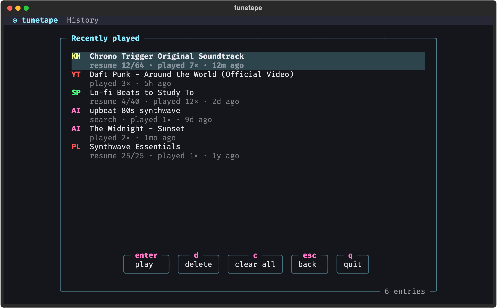
</p>

### Discover (AI)

Type what you feel like hearing and pick a song from the suggestions. Each one streams from YouTube.

<p align="center">
  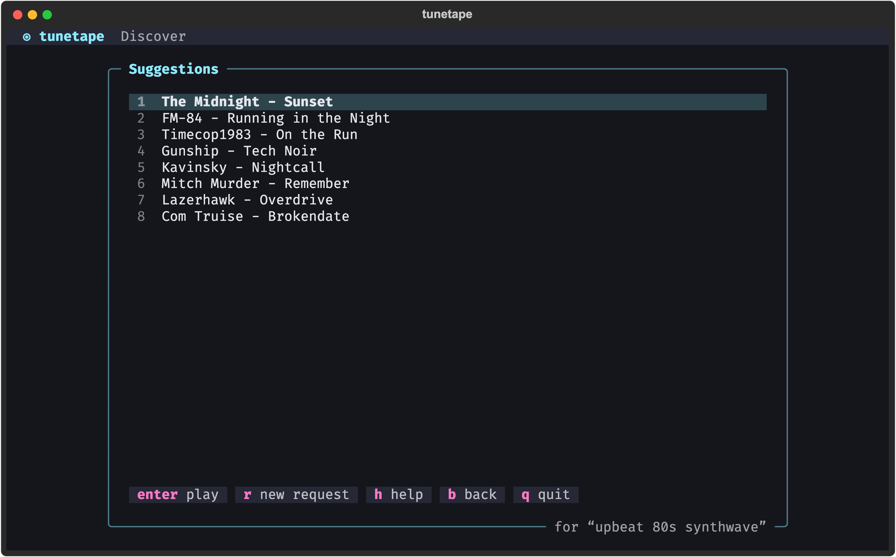
</p>

### Settings

Toggle loudness normalization, pick a theme, and set up AI discovery.

<p align="center">
  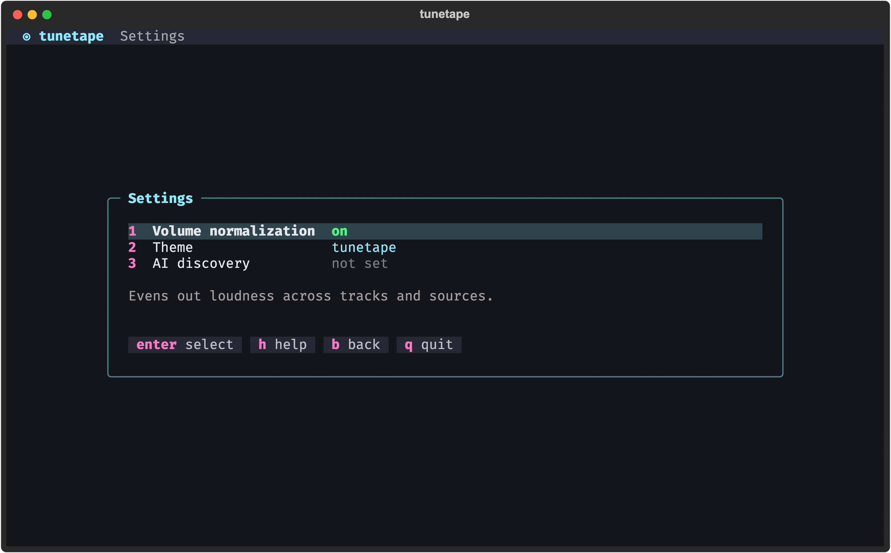
</p>

### Themes

Move through the list and the whole interface recolors as you go. Enter keeps the theme you're on; Esc puts the old one back. You can also switch themes from anywhere with **ctrl+p**.

<p align="center">
  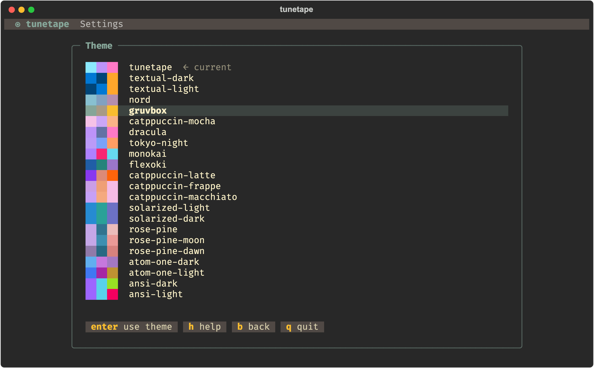
</p>

### Small terminals

Every screen adapts down to 60 columns. The welcome tuna shrinks to a pixel-art version, and below 96 columns the player's buttons keep just their keys.

<p align="center">
  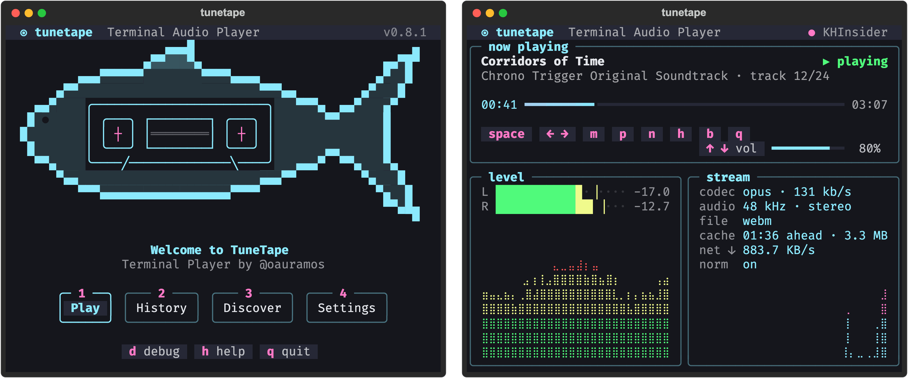
</p>

## Keys

The same keys work on every screen, and each screen's row of buttons ends with the same **h** help, **b** back and **q** quit. Buttons can be clicked too.

| Key | Action |
|:---:|--------|
| `b` `esc` | Back |
| `q` | Quit (the music stops too) |
| `h` `?` | Help: every key, on any screen |
| `ctrl+c` | Quit, even while typing or loading |
| `ctrl+p` | Command palette (themes) |

On screens with a text box, `b`, `q` and `h` type letters, so use `esc` to go back and `ctrl+c` to quit.

In the player:

| Key | Mouse | Action |
|:---:|:-----:|--------|
| `space` | click the button | Play / pause |
| `←` `→` | click the progress bar | Seek 10s |
| `,` `.` | | Seek 30s |
| `↑` `↓` | scroll the wheel, or click the gauge | Volume |
| `m` | click the button | Mute |
| `n` `p` | click the button | Next / previous track |
| `tab` | click a track | Browse the queue; Enter (or the click) plays that track |
| `b` `esc` | | Back to the menu; the music keeps playing, and **n** on the menu brings the player back |

The full reference is in the wiki: **[Usage and Controls](https://github.com/oauramos/tunetape/wiki/Usage-and-Controls)**.

## Learn more

The **[wiki](https://github.com/oauramos/tunetape/wiki)** has the details this page leaves out:

- [Installation](https://github.com/oauramos/tunetape/wiki/Installation): every install method, upgrading, uninstalling
- [Usage and Controls](https://github.com/oauramos/tunetape/wiki/Usage-and-Controls): each screen and every key
- [Sources](https://github.com/oauramos/tunetape/wiki/Sources): what links work and how each source is streamed
- [AI Discovery](https://github.com/oauramos/tunetape/wiki/AI-Discovery): Anthropic, OpenAI-compatible endpoints and local models
- [Settings](https://github.com/oauramos/tunetape/wiki/Settings): normalization, themes, where your data lives
- [Troubleshooting](https://github.com/oauramos/tunetape/wiki/Troubleshooting): playback stalls, missing tools, the Debug screen
- [FAQ](https://github.com/oauramos/tunetape/wiki/FAQ)

## Built with

- [mpv](https://mpv.io/), the media player doing the actual playback (its audio filters also feed the level meter)
- [yt-dlp](https://github.com/yt-dlp/yt-dlp), which resolves YouTube streams
- [Textual](https://github.com/Textualize/textual), which draws the terminal UI

## License

MIT. See [LICENSE](LICENSE).

## Disclaimer

**tunetape** does not store, host, download, or redistribute any content from YouTube, Spotify, KHInsider, or any other third-party service. It is a lightweight terminal-based streaming client that relies on publicly available tools ([mpv](https://mpv.io/), [yt-dlp](https://github.com/yt-dlp/yt-dlp)) to stream audio in real time. For Spotify, only public metadata (track names and artists) is read to locate the matching audio on YouTube; no Spotify audio is accessed.
